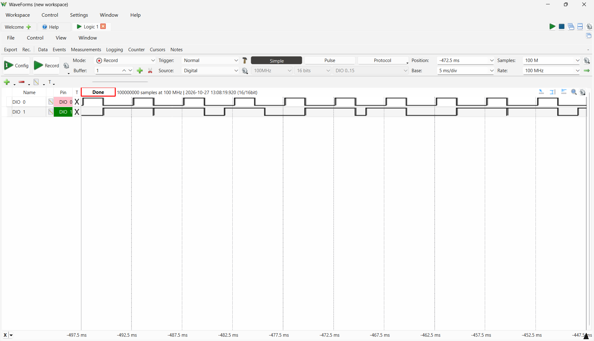
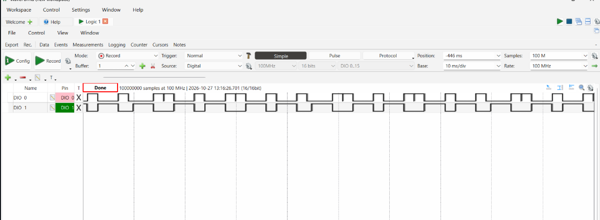
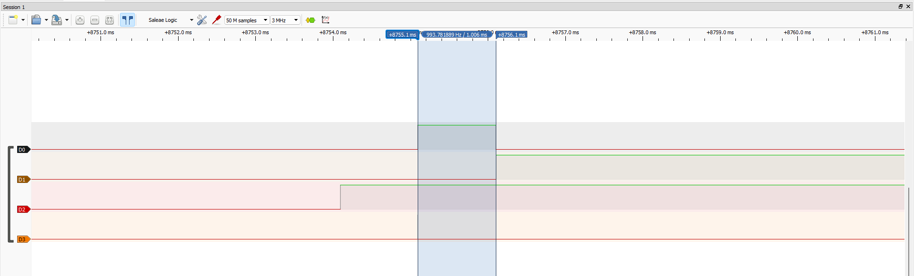
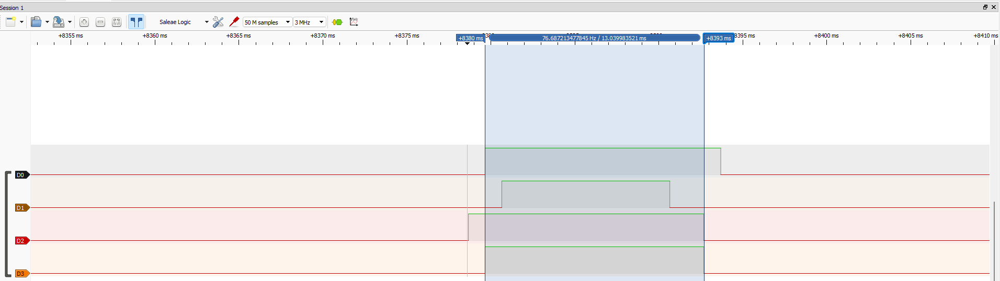
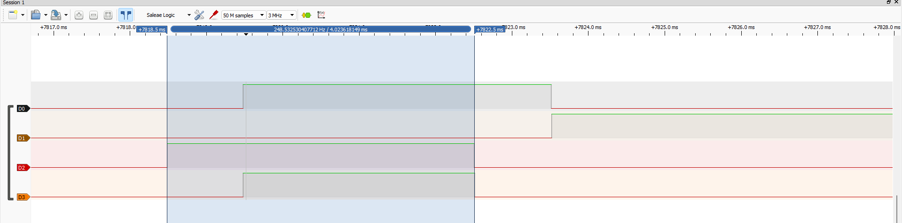

# Lab 06 / Week 6 — Schedulability: la teoría puesta a prueba

> **Contexto del Proyecto:**
> *"Eng. Samuel Cifuentes: Daniela pregunta si puede agregar dos sensores más al nodo. Hoy respondemos como ingenieros: no 'probemos a ver', sino 'la utilización da X, el test dice Y'. Y como no confío en los teoremas más que en ti, reproduce el caso famoso: un conjunto de tareas que RM pierde y EDF cumple, en nuestra placa y no en el libro."*
>
> Referencia: Buttazzo, *Hard Real-Time Computing Systems* (4.ª ed.), cap. 4 · Firmware: `firmware/sched_labs/` y `firmware/kernel/` · Scripts: `tools/scripts/` · Placa: ESP32-S3 DevKitC.

> **Estado de la evidencia (2026-11-04):** la guía oficial vigente (repositorio del curso) pide la Task A con el conjunto real de la Fig. 4.13, la Task B (inversión de prioridad, tres capturas) y la Task C (ADR-005: `calib` y e-stop). **Task B medida en nuestra placa** (consola y tres capturas de PulseView). **Task A**: las capturas son del compañero de pareja (WaveForms); en nuestra placa se midió además un conjunto sintético de tres tareas. **Task C (ADR-005) pendiente.** El jitter inyectado (stretch, no calificado) está medido. Los valores *predichos* siguen rotulados como tales; ninguna cifra medida se estima.

---

## §1 Tabla de Mediciones ("What You'll Measure")

| Medición | Predicción | Medido |
| :--- | :---: | :---: |
| **Fig. 4.13 bajo RM: ¿qué tarea falla y cuándo?** | `tau2`, primer trabajo, en t = 7 ms (simulación, §3 Task A) | `tau2` falla en t = 7 ms y su pulso termina en 8 ms, **según el compañero de pareja** (WaveForms, captura sin anotar); no repetido en nuestra placa con este conjunto |
| **Fig. 4.13 bajo EDF: fallos en 60 s** | 0 (U = 0.971 ≤ 1) | 0 en 60 s, **según el compañero de pareja**; no verificado por nosotros |
| **R máx de `control`: sin contención / inversión (`k_sem`) / `k_mutex`** | 1 ms / ≈ 14 ms (cota 15) / ≤ 5 ms (esperado ≈ 4) | **1.013 ms / 14.037 ms (301 de 301 fallos) / 4.038 ms (0 fallos)**, consola de nuestra placa |
| **B: sección crítica más larga de `slow`** | 4 ms | **4.024 ms** (ancho de D2 con `k_mutex`, cursores de PulseView, y consola) |
| **`calib`: CPU y duración, antes y después del arreglo** | ⏳ | ⏳ (Task C, pendiente) |
| **E-stop: detección → válvula baja, máx de 5 disparos, antes y después** | ⏳ | ⏳ (Task C, pendiente) |

**Extras medidos (no son parte de la guía oficial):** conjunto sintético de tres tareas (U = 0.9667): RM pierde `tau3` a los 149.997 ms y EDF cumple; error del lazo con jitter inducido de 0 / 2 / 5 ms = 12 / 12 / 12 mV (stretch no calificado).

--- | :---: | :---: |
| **U del conjunto sintético (3 tareas)** | 0.9667 (calculado) | diseñado a U ≈ 0.97 ✔ |
| **Deadline miss bajo RM (¿qué tarea, cuándo?)** | **Sí: `tau3`**; D3 sube **149.997 ms** después del primer pulso de `tau1` (cursores de PulseView); 67 de 134 jobs fallan, peor respuesta 170.054 ms | sí: `tau3`, primer job, en t = 150 ms (simulación) |
| **Deadline miss bajo EDF** | **No**: 0 fallos; peor respuesta de `tau3` = 140.103 ms; D3 se queda abajo | no: peor respuesta de `tau3` = 140 ms ≤ 150 ms (simulación) |
| **Error del lazo con jitter inducido de 0 / 2 / 5 ms** | **12 / 12 / 12 mV** (una corrida por N, resolución 1 mV) | 12.2 / 12.2 / 12.4 mV (simulación, ver §3 Task C) |

---

## §2 Supuestos y decisiones

* **Parámetros de la Fig. 4.13.** La guía oficial los da: τ1 (C = 2 ms, T = 5 ms) y τ2 (C = 4 ms, T = 7 ms), U = 0.971. Una versión anterior de la guía, la del repositorio, no los traía; con ella se hizo un conjunto sintético de tres tareas que se conserva como extra (§3). Escala del conjunto sintético: 1 unidad del libro = 10 ms.
* **Parámetros de Daniela.** Las dos tareas nuevas "se dan en clase" y no están en el repo: §4 deja el cálculo parametrizado y calcula cuánta utilización caben, sin inventar sus valores.
* **$C_i$ del nodo.** Los únicos $C_i$ registrados son los de la Semana 2 (L476RG, analizador lógico + PulseView). Los del ESP32-S3 se re-miden en el Lab 05.

---

## §3 Week-6 Evidence

### Task A — Fig. 4.13, en vivo

#### Conjunto oficial: τ1 (C = 2 ms, T = 5 ms) y τ2 (C = 4 ms, T = 7 ms)

**Predicción** (`python3 tools/scripts/sched_sim.py sim --tasks "2:5,4:7" --timeline 20`, 1 carácter = 1 ms, U = 0.9714, hiperperiodo 35 ms):

```text
--- RM ---
DEADLINE MISS: tau2 job 1 released at t=0, deadline t=7, still has work left at t=7
tau1  ##...##.............
tau2  ..###...............

--- EDF ---
no miss over 35 units
worst response (completed jobs): {'tau1': 4, 'tau2': 6}
```

`tau2` recibe CPU en [2,5), `tau1` lo desaloja en t = 5 y `tau2` no termina hasta t = 8: pierde su deadline de 7 ms. Bajo EDF ambas cumplen (respuestas máximas 4 y 6 ms). Los tests suficientes no deciden este conjunto (Liu & Layland 0.8284 y hiperbólico 2.2 fallan), pero EDF sí lo respalda (U ≤ 1).

**Evidencia.** Estas dos capturas **no son nuestras**: las tomó el compañero de pareja con su firmware y con WaveForms (Digilent, 100 MHz, 100 M muestras, DIO0 = `tau1`, DIO1 = `tau2`); se incluyen atribuidas a él. Son capturas de pantalla sin anotar (sin cursores). Los resultados que reporta en su informe son: RM, `tau2` falla en t = 7 ms con el pulso extendido hasta 8 ms; EDF, 0 fallos en 60 s. No los repetimos en nuestra placa con este conjunto.





**Pendiente:** el firmware de este repositorio (`firmware/sched_labs`) implementa el conjunto sintético de abajo, no este. Para que el código del repositorio coincida con la evidencia de la Fig. 4.13 hace falta adaptarlo a τ1/τ2 y repetir las dos capturas y el run de 60 s de EDF.

#### Extra: conjunto sintético de tres tareas, medido en nuestra placa

**Conjunto de tareas** (implementado en `firmware/sched_labs/src/lab06.c`, "cómputo" = espera activa calibrada `burn_ms`):

| Tarea | $C_i$ (ms) | $T_i = D_i$ (ms) | $U_i$ | Pin analizador | Prioridad RM |
| :--- | :---: | :---: | :---: | :---: | :---: |
| `tau1` | 10 | 50 | 0.200 | D0 (GPIO4) | 3 (más alta) |
| `tau2` | 30 | 60 | 0.500 | D1 (GPIO5) | 4 |
| `tau3` | 40 | 150 | 0.267 | D2 (GPIO6) | 5 |
| | | | **0.967** | D3 (GPIO7) = latch de miss | |

* **Liberación.** Cada tarea la libera un `k_timer` (ISR que estampa `k_cycle_get_32`), las tres dentro del mismo tick: liberación síncrona en t = 0, que es el instante crítico.
* **Pines.** D0–D2 suben en el primer despacho de un job y bajan al completarlo (con preemption, el pulso incluye el tiempo en que fue desalojado). D3 sube y **se queda arriba** en el primer deadline perdido.
* **RM:** prioridades fijas por periodo. **EDF:** una sola prioridad; al terminar cada job se fija con `k_thread_deadline_set` el deadline absoluto del siguiente (`CONFIG_SCHED_DEADLINE=y`).

**Predicción (simulación, `tools/scripts/sched_sim.py sim --timeline 30`, 1 carácter = 10 ms):**

```text
--- RM ---
DEADLINE MISS: tau3 job 1 released at t=0, deadline t=15, still has work left at t=15
      0    5    0    5    0    5
tau1  #....#....#...................
tau2  .###..###...###...............
tau3  ....#....#.#..................

--- EDF ---
no miss over 30 units
worst response (completed jobs): {'tau1': 2, 'tau2': 4, 'tau3': 14}
```

`tau3` recibe 1 unidad de CPU en [4,5), 1 en [9,10) y 1 en [11,12); `tau2` lo desaloja en t = 12 y, al llegar a t = 15, le falta 1 unidad: pierde su deadline. Bajo EDF, `tau3` termina en 14 unidades (140 ms).

**Cómo capturar:**

```bash
source ~/zephyrproject/zephyr/zephyr-env.sh 2>/dev/null || true
# RM
west build -p always -b esp32s3_devkitc/esp32s3/procpu firmware/sched_labs
# EDF
west build -p always -b esp32s3_devkitc/esp32s3/procpu firmware/sched_labs -- -DCONFIG_SCHED_LAB_EDF=y
west flash -r esp32
```

PulseView: canales D0–D3, ≥ 100 kHz, ventana ≥ 600 ms (2 hiperperiodos), disparo en el flanco de subida de D0 justo después del reset. Consola (UART, 115200) al terminar los 20 s:

```text
-- RM (medido en la placa) --
sched_labs: Lab 06 Task A — rate-monotonic
burn_ms(10) took 9999 us with nothing else running
task   C[ms]  T[ms]   jobs  misses  dropped   worst[ms]
tau1      10     50    402       0        0      10.016
tau2      30     60    335       0        0      40.016
tau3      40    150    134      67        0     170.054
deadline missed: YES
scenario finished (0)

-- EDF (medido en la placa) --
sched_labs: Lab 06 Task A — EDF (SCHED_DEADLINE)
burn_ms(10) took 9999 us with nothing else running
task   C[ms]  T[ms]   jobs  misses  dropped   worst[ms]
tau1      10     50    402       0        0      40.087
tau2      30     60    335       0        0      40.067
tau3      40    150    134       0        0     140.103
deadline missed: no
scenario finished (0)
```

El resumen de RM se obtuvo dos veces (dos corridas de 20 s) con resultado idéntico.

Capturas de PulseView (Saleae Logic, 3 MHz, 50 M muestras, sin disparo; reset de la placa por RTS ≈ 8 s después de pulsar Run; las imágenes están en el commit `1e35db7`). Los cursores miden **149.997 ms** desde el primer pulso de `tau1` (D0, +9646 ms) hasta la subida de D3 (+9796 ms), que se queda arriba: el primer deadline perdido de `tau3`, a ≈ 150 ms como predijo la simulación. Los bloques anchos de D0–D3 antes de ≈ +9508 ms no son tareas: es el estado de los pines durante el arranque; en ≈ +9508 ms los cuatro bajan a la vez, que es lo que hace `instr_init()` (inferencia a partir del código, no medida aparte). La lectura de los cursores es de la imagen; no se exportó el VCD.

La peor respuesta medida de `tau3` (170.054 ms) es mayor que los 160 ms de la RTA exacta para el primer trabajo: se debe, probablemente, al retraso acumulado de los trabajos posteriores, hipótesis que no se verificó con los datos de la captura.

Bajo EDF el mismo conjunto cumple todos los deadlines: 0 fallos y la peor respuesta de `tau3` es **140.103 ms**, igual que los 140 ms de la simulación y por debajo de su deadline de 150 ms. Para `tau1` y `tau2` la peor respuesta sube respecto a RM (40.087 y 40.067 ms frente a 10.016 y 40.016 ms), porque EDF ya no les da prioridad fija; siguen dentro de sus deadlines.

PulseView con la misma configuración que RM (3 MHz, 50 M muestras, reset por RTS ≈ 8 s después de Run). El arranque, donde los cuatro canales bajan a la vez, queda en ≈ +5.6 s; desde ahí D0, D1 y D2 pulsan con regularidad y **D3 se queda abajo** en todo el tramo visible (≈ 4.5 s), sin la subida que en RM ocurría a ≈ 150 ms. El bloque alto de D3 al inicio es el estado de los pines durante el arranque, como en la captura de RM.

**Verificación de la calibración:** `main` imprime `burn_ms(10) took 9999 us with nothing else running` (medido); debe ser ≈ 10 000 µs, y lo es. Si se desvía, los $C_i$ efectivos no son los de la tabla.

### Task B — La inversión, luego la solución

Tres hilos en `firmware/sched_labs`: `control` (alta), `slow` (baja, comando de consola lento) y `medium` (media, trabajo intenso que nunca toca el lock). `control` y `slow` comparten el lock. Cada episodio dura 100 ms: `slow` arranca en +0, `control` en +1 y `medium` en +2 ms. Escenarios (cada uno corre 30 s, con `-DCONFIG_SCHED_LAB_RUN_S=30`):

```bash
west build -p always -b esp32s3_devkitc/esp32s3/procpu firmware/sched_labs -- -DCONFIG_SCHED_LAB_NOLOCK=y    -DCONFIG_SCHED_LAB_RUN_S=30   # sin contención
west build -p always -b esp32s3_devkitc/esp32s3/procpu firmware/sched_labs -- -DCONFIG_SCHED_LAB_INVERSION=y -DCONFIG_SCHED_LAB_RUN_S=30   # k_sem de 1
west build -p always -b esp32s3_devkitc/esp32s3/procpu firmware/sched_labs -- -DCONFIG_SCHED_LAB_PI=y        -DCONFIG_SCHED_LAB_RUN_S=30   # k_mutex (herencia)
```

PulseView (Saleae Logic, 3 MHz, 50 M muestras, sin disparo; reset por RTS ≈ 8 s después de pulsar Run). Canales: D0 = `control` ocupado (GPIO4), D1 = `medium` (GPIO5), D2 = `slow` con el lock (GPIO6), D3 = `control` bloqueado esperando el lock (GPIO7).

**Medido (consola, 301 episodios por escenario, deadline de `control` = 5 ms):**

| Escenario | R máx de `control` | Espera máx del lock | Fallos de deadline | `slow` con el lock (tiempo de pared) |
| :--- | :---: | :---: | :---: | :---: |
| Sin contención | **1.013 ms** | 0.000 ms | 0 | 15.025 ms (*) |
| `k_sem` (inversión) | **14.037 ms** | 13.029 ms | **301 de 301** | 14.022 ms |
| `k_mutex` (herencia) | **4.038 ms** | 3.029 ms | 0 | **4.024 ms = B** |

(*) Sin lock, `slow` no bloquea a nadie; esa cifra es solo su duración total, que incluye las preemptions de `control` y `medium` (4 + 1 + 10 ms).

El resultado coincide con la predicción (1 ms / ≈ 14 ms con cota de 15 / ≤ 5 ms): con un semáforo binario, `medium` se interpone entre `slow` y `control` y la espera de `control` (13 ms) supera con creces la sección crítica de `slow`; con herencia de prioridad la espera se reduce a lo que dura esa sección.

**Evidencia anotada** (cursores de PulseView):



Sin contención: los cursores miden **1.006 ms** en el pulso de D0 (`control`), `slow` (D2) empieza 1 ms antes, `medium` (D1) arranca cuando termina `control` y D3 queda plano abajo.



Inversión: D3 sube cuando `control` se bloquea y baja cuando toma el lock; los cursores miden **13.040 ms** entre ambos flancos (consola: 13.029 ms). Durante ese tramo `medium` (D1) corre ≈ 10 ms mientras `slow` (D2) tiene el lock, es decir, se interpone entre `slow` y `control`. `control` (D0) termina en ≈ 14 ms. Las duraciones de D1 y D0 son lecturas de la imagen, aproximadas; la de D3 es la medida por los cursores.



Mutex con herencia: los cursores sobre D2 miden **4.024 ms** (= B, igual que el `max slow CS wall` de la consola). D3 sube ≈ 1 ms después y baja con D2, unos 3 ms; `medium` (D1) arranca justo cuando termina `control`, sin interponerse. Las duraciones de D0, D3 y D1 son lecturas de la imagen, aproximadas; la de D2 es la medida por los cursores.

### Task C — Arreglarlo en la fuente (ADR-005)

⏳ **Pendiente.** Requisitos de la guía:

* **REQ-CONS-01.** `calib` necesita ≈ 400 ms de CPU dentro de un plazo de 1 s, en la prioridad más baja. Arreglo: `k_busy_wait(400)` → `k_usleep(400)` en `cmd_calib`. Hay que comprobar si 1000 esperas caben en 1 s: con el tick de 1 kHz de `firmware/kernel` (`CONFIG_SYS_CLOCK_TICKS_PER_SEC=1000`) cada `k_usleep` se redondea al tick de 1 ms (hipótesis, sin medir).
* **REQ-ESTOP-01.** Tras la detección, la válvula solo se cierra cuando el siguiente `control` pone el duty en 0 y el paso PWM siguiente escribe el pin. Arreglo: poner también `duty_pct = 0` en la rama del e-stop de `task_sampling`. Suma del peor caso de los periodos frente a 5 ms.
* **Medición «antes».** `instr_set(&instr_flow, estop);` tras el check de e-stop y un canal del analizador en la válvula (GPIO21); `set 3300` dispara el e-stop y `set 1500` y `clear` lo reponen.
* **Evidencia:** filas antes/después, una captura del e-stop de cada una y las dos sumas. ADR-005 con las cifras.

### Stretch (no calificado) — Jitter vs. control (el puente a teoría de control)

**Inyección.** `CONFIG_LAB06_JITTER_MAX_MS=N` hace que cada ciclo de control espere un número entero de ms pseudoaleatorio en [0, N] **antes** de escribir el duty de la válvula (PRNG xorshift32 de semilla fija: cada corrida repite los mismos retardos). La ruta de e-stop nunca se retrasa. N = 0 compila la inyección fuera: es el lazo original.

**Métrica.** `status` imprime `loop_err_mv`: el promedio de |setpoint − presión| sobre los ciclos de control desde el último `set <mv>`; `set` reinicia la ventana.

```bash
west build -p always -b esp32s3_devkitc/esp32s3/procpu firmware/kernel -- -DCONFIG_LAB06_JITTER_MAX_MS=<N>   # N = 0, 2, 5
west flash -r esp32
# consola: esperar ~10 s tras el arranque (planta estable en 1500 mV), luego:
#   set 2000        <- escalón 1500 -> 2000 mV, abre la ventana
#   (esperar 10 s)
#   status          <- leer loop_err_mv
```

Usar la planta sintética (sin `pot_esp32.overlay`): con el potenciómetro la presión no responde al duty y el error no mide el lazo.

| N (ms) | `loop_err_mv` medido | Predicción (simulación) |
| :---: | :---: | :---: |
| 0 | **12 mV** | 12.2 mV |
| 2 | **12 mV** | 12.2 mV |
| 5 | **12 mV** | 12.4 mV |

**Medido (2026-11-04).** Una corrida por valor de N (`status` a los 10 s del escalón `set 2000`, salida entera en mV, sin FATAL), con el firmware por defecto de `firmware/kernel` (tracing activo, sin lector en el puerto USB). `status` imprimió `jitter_max_ms=0`, `2` y `5`, lo que confirma que la inyección compilada es la pedida. Los tres resultados son iguales dentro de la resolución de 1 mV y coinciden con la predicción (12.2, 12.2 y 12.4 mV): **un retardo de hasta 5 ms no degrada el lazo de forma apreciable**. No hay barrido en N ni repeticiones, así que no se puede afirmar nada más fino que ±1 mV.

**Predicción (`tools/scripts/loop_jitter_sim.py --sweep`, promedio de 8 semillas de ruido, ±0.5 mV):**

| N (ms) | 0 | 2 | 5 | 10 | 20 | 30 | 40 | 50 |
| :--- | :---: | :---: | :---: | :---: | :---: | :---: | :---: | :---: |
| mean \|e\| (mV) | 12.0 | 11.7 | 12.3 | 12.1 | 12.2 | 14.5 | 16.5 | 20.9 |
| vs N = 0 | ×1.00 | ×0.98 | ×1.03 | ×1.01 | ×1.02 | ×1.21 | ×1.37 | ×1.75 |

*(Corrida de semilla única; en el promedio de 8 semillas: N=0 → 12.2, N=2 → 12.2, N=5 → 12.4, N=30 → 15.0, N=50 → 20.8 mV.)*

**Lectura de la predicción (confirmada en la placa solo para N ≤ 5; la degradación hacia N ≈ 30 ms no se midió y sigue siendo predicción).** Con esta planta (constante de tiempo ≈ 64 ms) y un periodo de control de 10 ms, un retardo de hasta 5 ms **no degrada de forma apreciable** el lazo: las diferencias están dentro del ruido de la simulación. El error residual de ≈ 12 mV lo domina la zona muerta del integrador (`error/8` trunca a 0 por debajo de 8 mV: sin ruido de planta la simulación converge a ≈ 7 mV) más el ruido de ±3 mV de la planta; no es jitter. La degradación se hace visible hacia N ≈ 30 ms (+21 %) y marcada en N = 50 ms (+75 %), cuando el retardo supera la constante de tiempo de la planta y el lazo empieza a oscilar (la desviación estándar del duty sube de 1.2 % a 2.5 %). Si la medición confirma esto, la respuesta a "¿a partir de qué N deja de ser útil el lazo?" es: **N ≈ 30 ms para esta planta**, no los 2–5 ms del enunciado.

> **[CAPTURA OPCIONAL]** `labs/img/lab06_taskC_ctrl_pulse.png` — `instr_ctrl` (GPIO5 del nodo `firmware/kernel`) con N = 5: el ancho del pulso de control varía entre ≈ 0 y 5 ms. Confirma que la inyección está activa.

---

## §4 Tarea para la casa — Schedulability: ¿cabe la carga nueva?

### 4.1 El nodo real, con $C_i$ medidos

Instrumento de cada $C_i$: analizador lógico + PulseView (GPIO), L476RG superloop, Lab 02.

| Tarea | $C_i$ (µs) | $T_i$ (µs) | $U_i$ |
| :--- | :---: | :---: | :---: |
| Sampling | 6.0 | 1 000 | 0.006000 |
| Control | 12.5 | 10 000 | 0.001250 |
| Telemetry | 45.0 | 1 000 000 | 0.000045 |
| ISR de flujo | 4.2 | 1 000 *(supuesto: inter-arribo mínimo, no medido)* | 0.004200 |
| **U** | | | **0.011495** |

`python3 tools/scripts/sched_sim.py tests --preset node`

* **Liu & Layland** (n = 4): cota = 4(2^{1/4} − 1) = **0.7568** → U = 0.0115 ≤ cota ✔
* **Hiperbólico:** Π(U_i + 1) = **1.0115** ≤ 2 ✔
* **EDF:** U ≤ 1 ✔
* **Veredicto:** el nodo es planificable con RM; el test que lo respalda es Liu & Layland (suficiente y se cumple).

**Salvedades.** (1) Son $C_i$ del L476RG: en el ESP32-S3 `telemetry` imprime por UART *polled* y bloquea ≈ 7 ms a 115200 (comentario en `main.c`), así que su $C_i$ real será mucho mayor que 45 µs (U_tele ≈ 0.007); se re-mide. (2) Los tests de utilización ignoran el bloqueo (Lab 07) y el deadline de 5 ms del e-stop, que exige análisis de tiempo de respuesta.

### 4.2 "Las dos tareas de Daniela"

Sus parámetros no están en el repo. Con n = 6 tareas, la cota de Liu & Layland es 6(2^{1/6} − 1) = **0.7348**; con el nodo en U = 0.0115 queda un margen de **0.7233** de utilización:

```bash
python3 tools/scripts/sched_sim.py tests --preset node --room 2
python3 tools/scripts/sched_sim.py tests --preset node --extra "sensor_a:<C>:<T>,sensor_b:<C>:<T>"   # con sus C y T (µs)
```

| | $C$ (µs) | $T$ (µs) | $U$ |
| :--- | :---: | :---: | :---: |
| Sensor A | ⏳ ____ | ⏳ ____ | ⏳ ____ |
| Sensor B | ⏳ ____ | ⏳ ____ | ⏳ ____ |
| **U total (nodo + A + B)** | | | ⏳ ____ |

**Regla de decisión (ya calculada):** las dos tareas caben **si U_A + U_B ≤ 0.7233** (Liu & Layland, condición suficiente). Si el total supera 0.7348, el hiperbólico puede aún aprobarlo; si ambos fallan y U ≤ 1, el conjunto no está decidido y se resuelve con RTA (Lab 07).

### 4.3 Por qué los tests suficientes no bastan: el conjunto de Task A

`python3 tools/scripts/sched_sim.py tests --tasks "tau1:1:5,tau2:3:6,tau3:4:15"`:

| Test | Resultado |
| :--- | :---: |
| Liu & Layland (n = 3): U = 0.9667 vs cota 0.7798 | ✘ falla |
| Hiperbólico: Π = 2.280 vs 2 | ✘ falla |
| EDF: U ≤ 1 | ✔ |

Ambos tests suficientes para RM fallan, así que **no deciden**; la simulación exacta (Task A) muestra que RM efectivamente pierde `tau3`, y el RTA exacto del Lab 07 lo confirma: `python3 tools/scripts/rta.py --tasks "tau1:1:5,tau2:3:6,tau3:4:15" --unit units` converge a $R_{\tau_3}$ = 16 > $D$ = 15 unidades. Por eso RM no es la respuesta a U = 0.97 y EDF sí: es la lección de la figura del libro.

> **FreeRTOS.** Solo trae prioridades fijas (no hay EDF en el kernel): Task A no es reproducible tal cual. Con U = 0.97 la respuesta profesional es rediseñar el conjunto hasta que pase el test de RM (o bajar U).

---

## §5 Checklist de evidencia pendiente

- [x] Task A: capturas de RM y EDF del conjunto oficial (del compañero de pareja, atribuidas, sin anotar)
- [ ] Task A: adaptar `firmware/sched_labs` a τ1/τ2, repetir RM y EDF en nuestra placa y el run de 60 s de EDF
- [x] Task B: tres capturas anotadas (`lab06_taskB_nolock.png`, `lab06_taskB_inversion.png`, `lab06_taskB_pi.png`) y resúmenes de consola; B = 4.024 ms
- [ ] Task C (ADR-005): `calib` con `k_usleep` y e-stop con `duty_pct = 0`, medición antes y después, capturas del e-stop, sumas y ADR-005
- [x] Stretch: jitter inyectado N = 0, 2, 5 (12 / 12 / 12 mV); N ≈ 30 ms sigue siendo predicción
- [ ] Parámetros de Daniela en §4.2 y U total
- [ ] ADR-002 con B medido y sección de planificabilidad con la salida de `rta.py` frente a lo medido
